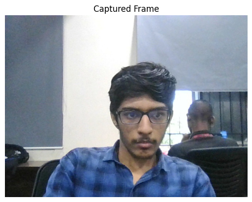
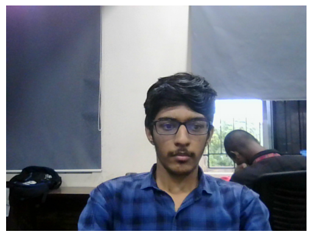
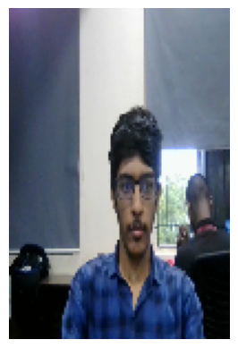
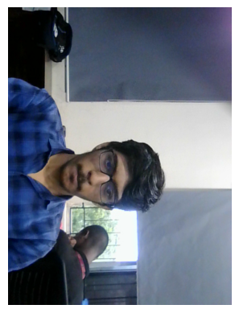

# Experiment 2: Image Acquisition and Video Processing Using OpenCV

**Name:** Mithik jain G  
**Register Number:** 212224240087  

---

## Aim:
To write a Python program using OpenCV to capture an image from the webcam and perform the following operations:
- Write the frame as a JPG file
- Display the video
- Display the video by resizing the window
- Rotate and display the video

---

## 🛠️ Software Used:
- **Anaconda** – Python 3.7+
- **Jupyter Notebook / VS Code**
- **OpenCV (`cv2`)**
- **Matplotlib (`matplotlib.pyplot`)**

---

## ⚙️ Algorithm:
- **Step 1:** Import the required libraries (`cv2`, `matplotlib.pyplot`, `time`, `clear_output`) and initialize the webcam using `cv2.VideoCapture(0)`.
- **Step 2:** Capture frames continuously from the webcam using `cap.read()`.
- **Step 3:** Save a frame as a JPG image using `cv2.imwrite()`.
- **Step 4:** Display the live video stream using `cv2.imshow()` or `plt.imshow()` with `clear_output()`.
- **Step 5:** Resize the frame using `cv2.resize()` and rotate it using `cv2.rotate(frame, cv2.ROTATE_90_CLOCKWISE)`, then display the processed frames.
- **Step 6:** Release the video capture object using `cap.release()` and close all active windows using `cv2.destroyAllWindows()`.

---

## 💻 Program:
```python
# ==============================================================================
# Developed By: Mithik jain G
# Register No: 212224240087
# Experiment 2: Image Acquisition and Video Processing Using OpenCV
# ==============================================================================
```

### i) Write the frame as JPG file

#### Standard OpenCV Script:
```python
import cv2

videoCaptureObject = cv2.VideoCapture(0)

ret, frame = videoCaptureObject.read()
if ret:
    cv2.imwrite("captured_image.jpg", frame)
    print("Frame successfully saved as captured_image.jpg")

videoCaptureObject.release()
cv2.destroyAllWindows()
```

#### Jupyter Notebook Implementation:
```python
import cv2
import matplotlib.pyplot as plt

# Initialize webcam
cap = cv2.VideoCapture(0)
ret, frame = cap.read()
if ret:
    cv2.imwrite("captured_frame.jpg", frame)
cap.release()

# Read and display the captured image
captured_image = cv2.imread('captured_frame.jpg')
plt.imshow(captured_image[:, :, ::-1])
plt.title('Captured Frame')
plt.axis('off')
plt.show()
```

---

### ii) Display the video

#### Standard OpenCV Script:
```python
import cv2

videoCaptureObject = cv2.VideoCapture(0)

while True:
    ret, frame = videoCaptureObject.read()
    if not ret:
        break
    cv2.imshow('Live Video', frame)
    if cv2.waitKey(1) == ord('q'):
        break

videoCaptureObject.release()
cv2.destroyAllWindows()
```

#### Jupyter Notebook Implementation:
```python
import cv2
import matplotlib.pyplot as plt
from IPython.display import clear_output
import time

cap = cv2.VideoCapture(0)

for i in range(50):
    ret, frame = cap.read()
    if not ret:
        break
    frame_rgb = cv2.cvtColor(frame, cv2.COLOR_BGR2RGB)
    clear_output(wait=True)
    plt.imshow(frame_rgb)
    plt.title('Displaying Live Video')
    plt.axis('off')
    plt.show()
    time.sleep(0.05)

cap.release()
```

---

### iii) Display the video by resizing the window

#### Standard OpenCV Script:
```python
import cv2

videoCaptureObject = cv2.VideoCapture(0)

while True:
    ret, frame = videoCaptureObject.read()
    if not ret:
        break
    # Resize frame to resolution (640, 480)
    resized_frame = cv2.resize(frame, (640, 480))
    cv2.imshow('Resized Video (640x480)', resized_frame)
    if cv2.waitKey(1) == ord('q'):
        break

videoCaptureObject.release()
cv2.destroyAllWindows()
```

#### Jupyter Notebook Implementation:
```python
import cv2
import matplotlib.pyplot as plt
from IPython.display import clear_output
import time

cap = cv2.VideoCapture(0)

for i in range(50):
    ret, frame = cap.read()
    if not ret:
        break
    resized_frame = cv2.resize(frame, (100, 150))
    frame_rgb = cv2.cvtColor(resized_frame, cv2.COLOR_BGR2RGB)
    clear_output(wait=True)
    plt.imshow(frame_rgb)
    plt.title('Resized Video')
    plt.axis('off')
    plt.show()
    time.sleep(0.05)

cap.release()
```

---

### iv) Rotate and display the video

#### Standard OpenCV Script:
```python
import cv2

videoCaptureObject = cv2.VideoCapture(0)

while True:
    ret, frame = videoCaptureObject.read()
    if not ret:
        break
    # Rotate 90 degrees clockwise
    rotated_frame = cv2.rotate(frame, cv2.ROTATE_90_CLOCKWISE)
    cv2.imshow('Rotated Video (90 Clockwise)', rotated_frame)
    if cv2.waitKey(1) == ord('q'):
        break

videoCaptureObject.release()
cv2.destroyAllWindows()
```

#### Jupyter Notebook Implementation:
```python
import cv2
import matplotlib.pyplot as plt
from IPython.display import clear_output
import time

cap = cv2.VideoCapture(0)

for i in range(50):
    ret, frame = cap.read()
    if not ret:
        break
    rotated_frame = cv2.rotate(frame, cv2.ROTATE_90_CLOCKWISE)
    frame_rgb = cv2.cvtColor(rotated_frame, cv2.COLOR_BGR2RGB)
    clear_output(wait=True)
    plt.imshow(frame_rgb)
    plt.title('Rotated Video (90° Clockwise)')
    plt.axis('off')
    plt.show()
    time.sleep(0.05)

cap.release()
```

---

## Output:

### i) Write the frame as JPG image
Captured image is saved as `captured_image.jpg`.



---

### ii) Display the video
Live webcam video stream is displayed.



---

### iii) Display the video by resizing the window
Video stream is shown in resized resolution.



---

### iv) Rotate and display the video
Video stream is displayed after rotating 90° clockwise.



---

## Result:
Thus, the image is successfully captured from the webcam and various video processing operations such as saving, displaying, resizing, and rotating are performed using OpenCV.

